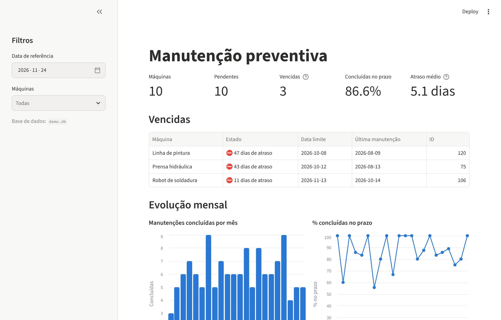

# 🛠️ Industrial Machine Maintenance Manager

Schedule and track preventive maintenance for industrial machines. Register machines, set the
interval until the next service, and get **alerts** when maintenance is due or overdue. Built in
**Python** on a shared **SQLite** data layer, with a **FastAPI REST API**, a **Tkinter** desktop app,
and a **data pipeline (Polars + DuckDB → Parquet)** feeding a **Streamlit** dashboard.



[](https://github.com/eslobas/industrial-machine-manager/actions/workflows/ci.yml)


> Interface and code comments are in Portuguese.

---

## ✨ Features

- **Machine registry** — create, search, update and delete maintenance records.
- **Automatic scheduling** — given a service date and an interval (days), the app computes the
  next **due date** (`data_limite`).
- **Status tracking** — mark interventions as completed, with notes and parts replaced.
- **Alerts** — `alertas_manutencao.py` lists machines whose maintenance is due/overdue and shows a
  native Windows notification (falls back to console on other systems); each run is logged.

## 🧱 How it works

```
repositorio.py         ─ data layer: SQLite access, validation, typed errors (no UI code)
api/                   ─ FastAPI REST API, built on repositorio.py
analytics/pipeline.py  ─ ETL: SQLite → Polars → data-quality checks → DuckDB SQL → Parquet
dashboard/app.py       ─ Streamlit dashboard on top of the pipeline
scripts/gerar_dados_demo.py ─ synthetic demo data generator (fixed seed)
Dockerfile             ─ container image for the API (+ docker-compose.yml)
gestao_manutencao.py   ─ Tkinter GUI, built on repositorio.py
alertas_manutencao.py  ─ standalone alert checker (run on login / via Task Scheduler)
tests/                 ─ pytest suite (data layer, API, pipeline, dashboard)
manutencao.db          ─ SQLite database (created automatically on first run)
abrir_gestao.bat       ─ Windows launcher
```

The data layer is UI-agnostic: it raises `DadosInvalidos`, `ManutencaoNaoEncontrada` or
`ManutencaoJaConcluida` instead of showing dialogs, so any front end can reuse it. The database
path defaults to `manutencao.db` next to the code and can be overridden with the
`MANUTENCAO_DB` environment variable.

**Schema** (`manutencao`): `id`, `nome_maquina`, `data_manutencao`, `dias_para_proxima`,
`data_limite`, `concluida`, `data_conclusao`, `notas`, `pecas_trocadas`.

## 🚀 Getting started

**Prerequisites:** Python 3.8+ for the desktop app (standard library only — `tkinter`,
`sqlite3`); Python 3.11+ for the REST API.

```bash
# Run the app (creates manutencao.db on first launch)
python gestao_manutencao.py

# Check for due/overdue maintenance
python alertas_manutencao.py            # add --pausa to keep the window open
```

On Windows you can double-click `abrir_gestao.bat`. To get daily alerts, schedule
`alertas_manutencao.py` with Windows Task Scheduler at login.

### REST API

```bash
pip install -r requirements.txt
uvicorn api.main:app --reload
```

Interactive docs at <http://localhost:8000/docs>. The API and the desktop app can share the same
`manutencao.db`.

| Method | Path | Description |
| --- | --- | --- |
| `GET` | `/health` | Liveness check |
| `GET` | `/manutencoes` | List all maintenance records (newest first) |
| `POST` | `/manutencoes` | Create a record; `data_limite` is computed → `201` + `Location` |
| `GET` | `/manutencoes/{id}` | Get one record → `404` if missing |
| `POST` | `/manutencoes/{id}/concluir` | Mark as completed (optional body: date, notes, parts) → `409` if already completed |
| `DELETE` | `/manutencoes/{id}` | Delete → `204` / `404` |
| `GET` | `/maquinas/{nome}/historico?ordem=asc\|desc` | Maintenance history of one machine |
| `GET` | `/alertas?data=YYYY-MM-DD` | Pending records due by that date (default today), with `dias_atraso` |

Invalid input returns `422`.

```bash
curl -X POST localhost:8000/manutencoes -H 'content-type: application/json' \
  -d '{"nome_maquina": "Torno CNC 2", "data_manutencao": "2026-11-24", "dias_para_proxima": 90}'
```

### Data pipeline & dashboard

```bash
pip install -r requirements-analytics.txt
python -m scripts.gerar_dados_demo --db demo.db         # synthetic data, fixed seed
python -m analytics.pipeline --db demo.db --out saida   # writes Parquet tables
MANUTENCAO_DB=demo.db streamlit run dashboard/app.py
```

The pipeline reads the operational SQLite database **read-only** and runs four stages:

1. **Extract** – `manutencao` table into a typed Polars DataFrame.
2. **Validate** – data-quality rules (inconsistent due date, completed without a completion date,
   completed before the service started, invalid dates). Failing rows are reported and excluded.
3. **Transform** – DuckDB SQL directly over the Polars frame: KPIs, per-machine compliance,
   monthly on-time rate, overdue list.
4. **Load** – one Parquet file per table (`kpis`, `por_maquina`, `mensal`, `vencidas`, `qualidade`).

The dashboard runs the same pipeline with a reference date and a machine filter, and shows KPIs,
overdue items, monthly trends and per-machine compliance, with CSV export.

> The demo data is **synthetic**: generated by `scripts/gerar_dados_demo.py` with a fixed seed,
> through the same repository validations as real input.

### Docker

```bash
docker compose up --build
```

The API is served on <http://localhost:8000> and the database lives in the named volume `dados`
(mounted at `/data`), so it survives container restarts and rebuilds. Without Compose:

```bash
docker build -t industrial-machine-manager-api .
docker run -p 8000:8000 -v imm-dados:/data industrial-machine-manager-api
```

The image (`python:3.13-slim`) contains only the API and the data layer, runs as a non-root user and
has a `HEALTHCHECK` on `/health`. The desktop app is not part of it.

### Tests

```bash
pip install -r requirements-dev.txt
python -m pytest
ruff check .
```

**CI** (GitHub Actions, `.github/workflows/ci.yml`) runs on every push and pull request: ruff lint,
the test suite on Python 3.11 / 3.12 / 3.13, a pipeline run on synthetic data, then builds the Docker image and smoke-tests the
running container (health check, create and fetch a record, 404 on a missing one).

## 🛠️ Tech stack

**Language** · Python 3 · SQL · **Data** · Polars · DuckDB · Parquet · Streamlit ·
**API** · FastAPI + Pydantic · **GUI** · Tkinter ·
**Storage** · SQLite (file-based) · **Tests** · pytest · **Container** · Docker · **CI** · GitHub Actions ·
**Platform** · cross-platform core, native notifications on Windows

## 🗺️ Roadmap

- [x] Per-machine history (API) and filters (dashboard)
- [x] CSV export of per-machine metrics; Parquet output from the pipeline
- [ ] Schedule the pipeline (e.g. an Airflow DAG) instead of running it by hand
- [ ] Cross-platform notifications (plyer)

---

<sub>Desktop project to practise Python, GUI development and local relational storage with SQLite.</sub>
